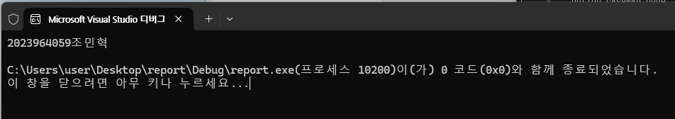

# MASM 학번·이름 출력 프로그램

Visual Studio 2026에서 MASM(Microsoft Macro Assembler)으로 작성한 x86 어셈블리 프로그램입니다.
실행하면 콘솔에 학번과 이름을 출력합니다.

- **학번:** 2023964059
- **이름:** 조민혁

## 개발 환경

| 항목 | 내용 |
|---|---|
| IDE | Visual Studio 2026 |
| 어셈블러 | MASM (ml.exe) |
| 플랫폼 | x86 (Win32) |
| 운영체제 | Windows |

## 파일 구성

```
report/
├── main.asm     # 어셈블리 소스 코드
├── result.png   # 실행 결과 화면
└── README.md
```

## 소스 코드

```asm
.386
.model flat, stdcall
.stack 4096
option casemap:none

includelib kernel32.lib

GetStdHandle  PROTO, nStdHandle:DWORD
WriteConsoleW PROTO, hConsoleOutput:DWORD, lpBuffer:PTR WORD, \
                     nNumberOfCharsToWrite:DWORD, lpNumberOfCharsWritten:PTR DWORD, \
                     lpReserved:DWORD
ExitProcess   PROTO, dwExitCode:DWORD

STD_OUTPUT_HANDLE EQU -11

.data
msg     dw '2','0','2','3','9','6','4','0','5','9'   ; 학번
        dw 0C870h, 0BBFCh, 0D601h                    ; 조민혁
        dw 13, 10                                    ; 줄바꿈 (CR LF)
msgLen  = ($ - msg) / 2
written dd ?

.code
main PROC
    INVOKE GetStdHandle, STD_OUTPUT_HANDLE
    INVOKE WriteConsoleW, eax, ADDR msg, msgLen, ADDR written, 0
    INVOKE ExitProcess, 0
main ENDP

END main
```

## 코드 설명

### 1. 기본 지시어
- `.386` : 80386 이상의 32비트 명령어를 사용합니다.
- `.model flat, stdcall` : 32비트 평면(flat) 메모리 모델과 Windows API 호출 규약인 `stdcall`을 사용합니다.
- `.stack 4096` : 스택 크기를 4096바이트로 지정합니다.
- `includelib kernel32.lib` : Windows API 함수가 들어 있는 라이브러리를 연결합니다.

### 2. Windows API 함수 선언 (`PROTO`)
| 함수 | 역할 |
|---|---|
| `GetStdHandle` | 콘솔 출력 장치의 핸들을 얻습니다. (`-11` = 표준 출력) |
| `WriteConsoleW` | 유니코드(UTF-16) 문자열을 콘솔에 출력합니다. |
| `ExitProcess` | 프로그램을 종료하고 종료 코드를 반환합니다. |

### 3. 데이터 영역 (`.data`)
한글이 깨지지 않도록 문자열을 **UTF-16 유니코드**로 저장했습니다. 한 글자당 2바이트(`dw`)를 사용합니다.

| 글자 | 유니코드 값 |
|---|---|
| 2, 0, 2, 3, 9, 6, 4, 0, 5, 9 | `'0'`~`'9'` 문자 그대로 저장 |
| 조 | `C870h` |
| 민 | `BBFCh` |
| 혁 | `D601h` |
| 줄바꿈 | `13`(CR), `10`(LF) |

- `msgLen = ($ - msg) / 2` : 문자열 전체 바이트 수를 2로 나눠 **글자 수**를 계산합니다. (`$`는 현재 주소)
- `written` : 실제로 출력된 글자 수를 받는 변수입니다.

### 4. 코드 영역 (`.code`)
1. `GetStdHandle`로 콘솔 출력 핸들을 받아 `eax`에 저장합니다.
2. `WriteConsoleW`에 핸들(`eax`), 문자열 주소, 글자 수를 넘겨 화면에 출력합니다.
3. `ExitProcess, 0`으로 프로그램을 정상 종료합니다.

## 빌드 및 실행 방법

1. Visual Studio 2026에서 **빈 프로젝트(C++)** 생성
2. 프로젝트 우클릭 → **빌드 종속성 → 빌드 사용자 지정** → `masm` 체크
3. `main.asm`을 소스 파일에 추가 (항목 형식: Microsoft Macro Assembler)
4. 플랫폼을 **x86**으로 설정
5. 프로젝트 속성 설정
   - 링커 → 시스템 → 하위 시스템: **콘솔 (/SUBSYSTEM:CONSOLE)**
   - 링커 → 고급 → 진입점: **main**
   - 링커 → 고급 → 진입점 없음: **아니요**
6. **Ctrl + F5**로 실행

## 실행 결과

```
2023964059조민혁

C:\Users\user\Desktop\report\Debug\report.exe(프로세스 7276)이(가) 0 코드(0x0)와 함께 종료되었습니다.
이 창을 닫으려면 아무 키나 누르세요...
```



- 첫 줄에 학번과 이름 `2023964059조민혁`이 정상적으로 출력되었습니다.
- 종료 코드 `0(0x0)`은 `ExitProcess, 0`에 의해 프로그램이 정상 종료되었음을 의미합니다.
- 아래 두 줄은 Visual Studio가 Ctrl+F5 실행 시 자동으로 표시하는 안내 문구입니다.
- 콘솔 화면에서 "조 민 혁"처럼 글자 간격이 넓어 보이는 것은 콘솔 글꼴이 한글을 전각 문자로 표시하기 때문이며, 실제 문자열에는 공백이 없습니다.

